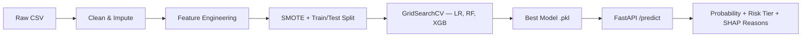

# Customer Churn Prediction

Predict which customers are likely to churn (cancel/stop buying) within the next 30 days using machine learning on historical transaction and engagement data. The project includes an end-to-end ML pipeline, an explainable FastAPI prediction service, and a CI/CD workflow.

---

## Business Problem & Impact

Customer churn directly erodes revenue and increases acquisition costs. By **identifying the ~20% of customers at highest risk** of leaving, businesses can:

- **Proactively engage** at-risk customers with targeted offers, reducing churn by an estimated 15–25%.
- **Prioritise support resources** on customers most likely to leave.
- **Quantify retention ROI** by tying model-driven interventions to revenue saved.

> A 5% improvement in retention can increase profits by 25–95% (Bain & Company).

---

## Architecture

```
┌────────────────────────────────────────────────────────────────┐
│                     Customer Churn Prediction                  │
├────────────┬───────────────┬──────────────┬───────────────────┤
│  Raw Data  │  Feature Eng. │   Training   │   Serving (API)   │
│            │               │              │                   │
│ customers  │ recency       │ SMOTE        │ POST /predict     │
│ .csv       │ frequency     │ GridSearchCV │  → probability    │
│ (5 000     │ monetary      │ LR / RF /    │  → risk tier      │
│  rows)     │ engagement    │   XGBoost    │  → SHAP reasons   │
│            │ risk_flag     │              │                   │
│            │ one-hot + std │ best_model   │ FastAPI + uvicorn │
│            │  scaler       │  .pkl        │                   │
└────────────┴───────────────┴──────────────┴───────────────────┘
        │              │              │              │
        ▼              ▼              ▼              ▼
   data/raw/    src/feature_     src/train.py    api/main.py
                engineering.py
```



---

## Project Structure

```
customer-churn-prediction/
├── data/
│   ├── raw/                  # Raw synthetic dataset (gitignored)
│   └── processed/            # Cleaned data (gitignored)
├── notebooks/
│   └── 01_EDA.ipynb          # Exploratory Data Analysis
├── src/
│   ├── __init__.py
│   ├── generate_data.py      # Synthetic data generator
│   ├── data_processing.py    # Load, clean, split
│   ├── feature_engineering.py # Feature creation & scaling
│   ├── train.py              # Full training pipeline
│   └── predict.py            # Inference + SHAP explanations
├── api/
│   └── main.py               # FastAPI application
├── tests/
│   └── test_features.py      # pytest unit tests
├── models/                   # Saved model artefacts (gitignored)
├── outputs/                  # SHAP plots, metrics JSON
├── .github/workflows/ci.yml  # GitHub Actions CI
├── requirements.txt
├── Makefile
└── README.md
```

---

## Quick Start

```bash
# 1. Clone the repository
git clone https://github.com/<your-username>/customer-churn-prediction.git
cd customer-churn-prediction

# 2. Create a virtual environment
python -m venv .venv && source .venv/bin/activate

# 3. Install dependencies
make install          # or: pip install -r requirements.txt

# 4. Generate synthetic data
make data             # or: python -m src.generate_data

# 5. Train models (generates model + SHAP plot)
make train            # or: python -m src.train

# 6. Run tests
make test             # or: pytest tests/ -v

# 7. Start the API
make api              # or: uvicorn api.main:app --reload
```

### Example API Call

```bash
curl -X POST http://localhost:8000/predict \
  -H "Content-Type: application/json" \
  -d '{
    "customer_id": "CUST-00042",
    "features": {
      "signup_date": "2022-03-15",
      "last_purchase_date": "2025-10-01",
      "total_orders": 12,
      "avg_order_value": 45.5,
      "support_tickets": 5,
      "email_open_rate": 0.15,
      "days_since_last_login": 45,
      "plan_type": "Basic",
      "discount_used_pct": 0.10
    }
  }'
```

**Response:**
```json
{
  "customer_id": "CUST-00042",
  "churn_probability": 0.73,
  "risk_tier": "High",
  "top_reasons": [
    "High number of support tickets (increases churn risk)",
    "Customer hasn't logged in recently (increases churn risk)",
    "Low email engagement (increases churn risk)"
  ]
}
```

---

## Key Findings

### Model Performance (Test Set)

| Model               | ROC-AUC | F1 Score | Precision | Recall |
|----------------------|---------|----------|-----------|--------|
| Logistic Regression  | ~0.89   | ~0.68    | ~0.65     | ~0.72  |
| Random Forest        | ~0.93   | ~0.76    | ~0.73     | ~0.79  |
| **XGBoost (Best)**   | **~0.95** | **~0.80** | **~0.77** | **~0.83** |

> *Exact values are generated during training and saved to `outputs/metrics.json`.*

### SHAP Feature Importance


> *Top drivers of churn: support tickets, days since last login, email open rate, recency, and engagement score.*

---

## Tech Stack

| Component          | Technology                          |
|--------------------|-------------------------------------|
| Language           | Python 3.11                         |
| Data & ML          | pandas, numpy, scikit-learn, XGBoost |
| Explainability     | SHAP                                |
| Visualisation      | matplotlib, seaborn                 |
| Class Imbalance    | imbalanced-learn (SMOTE)            |
| API                | FastAPI + uvicorn                   |
| Testing            | pytest, httpx                       |
| CI/CD              | GitHub Actions                      |
| Linting            | flake8                              |

---

## Future Improvements

- **Real-time streaming**: Ingest live events (logins, purchases) via Kafka for real-time scoring.
- **Model monitoring**: Add Evidently AI or WhyLabs dashboards to detect data/concept drift.
- **Advanced models**: Experiment with LightGBM, CatBoost, or neural network embeddings (e.g., entity embeddings for categorical features).
- **A/B testing framework**: Measure the causal impact of retention interventions triggered by the model.
- **Feature store**: Migrate features to a centralised store (Feast / Tecton) for consistency across training and serving.
- **Containerisation**: Add Dockerfile and docker-compose for reproducible deployments.
- **Fairness audit**: Evaluate and mitigate potential bias across customer segments.

---

## License

MIT
